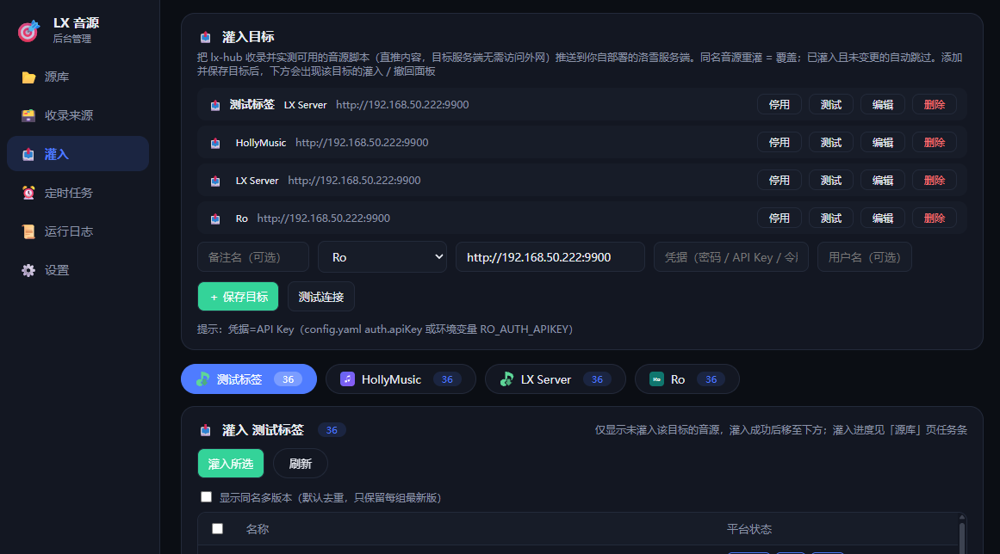
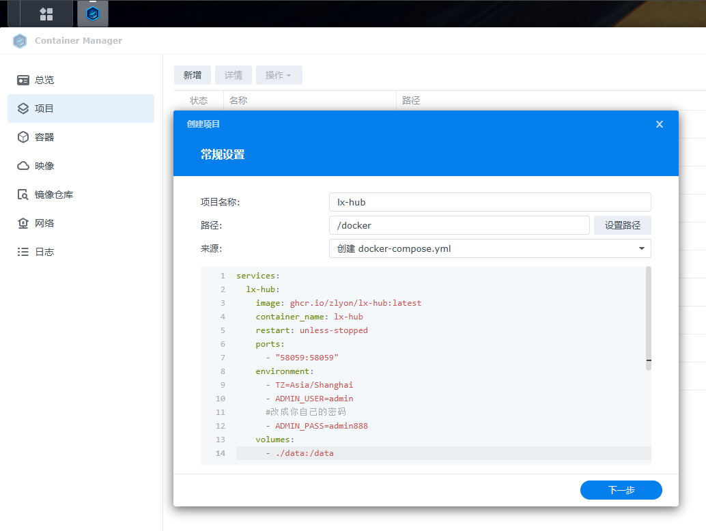

# 音源猎手 · 自部署版（lx-hub）

 

[音源猎手](https://github.com/zlyon/lx-hunter) 的自部署 Web 版：一键搜索公开渠道发布的洛雪（LX Music）自定义音源，自动实测各平台可用性，可一键打包导出全部可用音源 JS 文件。只索引公开链接与元数据，不提供、不存储任何音乐内容。插件负责在 [Songloft](https://github.com/songloft-org/songloft) 中用源，本项目负责在 Web 侧发现源、验源。

> 🌐 **在线演示**：<https://zlyon.github.io/lx-hub/> —— 由 GitHub Actions 每日自动实测，页面内可直接下载实测可用的音源脚本，无需部署。
>
> 🙌 本项目参考 [deerwan](https://github.com/deerwan) 的闭源项目 [lxhub.lllh.de](https://lxhub.lllh.de/) 制作。

## 主要功能

- **一键搜索**：扫描内置来源清单（远端热更新，无需更新镜像）+ 社区优选来源 + 自定义 GitHub 仓库，自动发现音源脚本并提取元数据
- **实测验源**：脚本放进沙箱真实加载，逐平台实测能否取到音频；列表只标实测通过的平台，取不到的标「存疑」
- **一键打包导出**：全部可用音源 JS 打成一个 ZIP，同名源根目录只放最新版，旧版归入「疑似早期版本」子目录
- **音源灌入**（测试阶段）：实测可用的音源一键批量灌入自建洛雪服务端，支持灌入与一键撤回
- **定时任务**：每天 / 每 N 天 / 每周 / 每月到点自动搜索 + 检测，运行日志自动留存
- **后台管理**：账号密码登录；仓库增删、代理 / 镜像 / jsDelivr 线路、调试日志、外网部署开关（勾选后前台移除扫描入口）
- **加速下载**：复制 / 下载 / 导出可选拼接 gh-proxy 形态镜像前缀，兼容器内直连、代理、jsDelivr 多线路

## 音源灌入（测试阶段）

后台「灌入」页可把本系统收录并实测可用的音源脚本**直推**到你自建的洛雪服务端（内容直推，目标服务端无需访问外网），支持灌入与一键撤回；同名重灌 = 覆盖，同版本已灌自动跳过。目前支持三类服务端：

| 类型 | 适用服务端 | 地址填什么 | 凭据填什么 | 用户名 |
| --- | --- | --- | --- | --- |
| LX Server | XCQ0607 / gefl24 及同协议版本 | `http://IP:端口` | 服务端后台管理密码（`ADMIN_PASSWORD`） | 留空即灌入公共源 |
| HollyMusic | [redcatH/HollyMusic](https://github.com/redcatH/HollyMusic) | `http://IP:端口` | 管理员密码 | 默认 `admin` |
| Ro | [leizi914599611-boop/ro](https://github.com/leizi914599611-boop/ro) | `http://IP:端口` | API Key（`config.yaml` 的 `auth.apiKey` 或环境变量 `RO_AUTH_APIKEY`） | 留空 |



使用流程：后台「灌入」页添加目标（选类型、填地址和凭据，可先「测试连接」）→ 保存后下方生成该目标的标签页 → 在「灌入」面板勾选音源批量直推；切到「已灌入」面板可随时撤回（只撤本系统灌入的音源，不影响手动添加的源）。

> 功能为测试阶段，有问题请带「运行日志」页的日志反馈。

## 部署

### Docker Compose（推荐）

```yaml
services:
  lxhub:
    image: ghcr.io/zlyon/lx-hub:latest
    container_name: lx-hub
    restart: unless-stopped
    ports:
      - "58059:58059"
    volumes:
      - ./data:/data
    environment:
      - TZ=Asia/Shanghai
      - LXHUB_HOST=0.0.0.0
      - LXHUB_PORT=58059
      - LXH_ADMIN_USER=${LXH_ADMIN_USER:-admin}
      - LXH_ADMIN_PASS=${LXH_ADMIN_PASS:-admin888}
```

改密码更省事的方式：不动 compose 文件，在 compose 同目录新建一个 `.env` 文件，写一行 `LXH_ADMIN_PASS=你的密码`——Docker Compose 会自动读取并覆盖默认值。

### 群晖 DSM（Container Manager）

打开 Container Manager →「项目」→「新建」：项目名称填 `lx-hub`，路径设置例如 `/docker`，来源选「创建 docker-compose.yml」，把上面的内容粘贴进去，一路下一步直到完成。构建启动后访问 `http://群晖IP:58059`，数据保存在 `/docker/lx-hub/data`。



### Node.js 直接部署

需要 Node.js ≥ 20（无任何 npm 依赖，不用 `npm install`）：

```bash
# 下载源码后，在项目目录执行：
node server.js
# 访问 http://localhost:58059
```

- 后台账户 / 密码用环境变量覆盖：`ADMIN_USER=你的账号 ADMIN_PASS=你的密码 node server.js`
- 想常驻运行：Linux 用 `pm2` 或 systemd，Windows 用任务计划 / `nssm` 注册为服务；群晖套件版 Node 亦可
- 数据在项目目录的 `data/` 下，备份该目录即可迁移

| 环境变量                            | 说明    | 默认                     |
| ------------------------------- | ----- | ---------------------- |
| `PORT` / `LXHUB_PORT`           | 监听端口  | `58059`                |
| `HOST` / `LXHUB_HOST`           | 监听地址  | 全部网卡                   |
| `DATA_DIR`                      | 数据目录  | `./data`（容器内 `/data`）  |
| `ADMIN_USER` / `LXH_ADMIN_USER` | 后台账户名 | `admin`                |
| `ADMIN_PASS` / `LXH_ADMIN_PASS` | 后台密码  | `admin888`（**部署务必修改**） |

两种变量名等价；Compose 部署推荐 `LXHUB_*` / `LXH_ADMIN_*`（配合 `${VAR:-默认值}` 写法，可用 `.env` 文件覆盖而不必改动 compose 文件）。

数据全部存于 `data/db.json`（单文件原子写入），调试日志在 `data/logs/`。资源占用极低，适合 NAS 常驻。

推送到 GitHub 后自动构建多架构镜像发布到 GHCR（内置 `GITHUB_TOKEN`，无需额外 secrets）。

## 在线演示站

仓库内置 `demo/` 目录与 `.github/workflows/demo-pages.yml`：GitHub Actions 每日定时执行一次完整搜索与沙箱实测，把「至少一个平台实测取到音频」的音源生成为纯静态页面（数据 JSON + 全量 ZIP），自动发布到 GitHub Pages。演示站完全独立于 Docker 镜像（Dockerfile 不包含 `demo/`），自部署用户不受任何影响；Fork 本仓库后会自动获得同款演示流水线（Pages 源选「GitHub Actions」即可）。可选优化：在仓库 Settings → Secrets and variables → Actions 添加 `DEMO_GH_TOKEN`（GitHub PAT，公开仓库只读权限即可），将搜索阶段的 GitHub API 限额从每小时 60 次提升到 5000 次，避免大仓库扫描中途被限流。

## 许可协议

本项目采用 [CC BY-NC-ND 4.0](https://creativecommons.org/licenses/by-nc-nd/4.0/deed.zh)（署名-非商业性使用-禁止演绎）授权：

- ✅ 个人自部署、非商业使用、原样转发（须保留本仓库链接与版权声明）
- ❌ 不得用于任何商业用途
- ❌ 不得移除、修改代码及界面中的版权信息（包括后台版权栏与源码头部声明）
- ❌ 不得分发修改后的版本（可自行修改自用，但不可对外发布）

## 免责声明

本工具仅收录并检查互联网上已公开发布的音源脚本链接；「可用」仅指该平台在最近一次检测中实测取到过音频，不代表所有歌曲均可播放。不存储、不提供任何音乐内容；导入外部音源脚本的安全风险由使用者自行承担。请勿用于商业用途。
